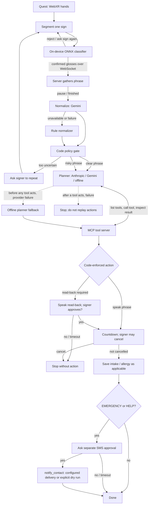

# Lumen

Sign language as an input modality for AI agents. A Meta Quest 3S tracks the signer's hands (WebXR hand
tracking, 21 joints per hand), a small model **on the headset** recognises isolated ASL signs, and an agent
turns the confirmed words into clinic-intake actions through **MCP tools**.

> **This README is a living document.** It records not just *what* the code does but *why* files exist,
> what was decided and rejected, and what went wrong along the way. The **work-order status** and
> **decisions / challenges** sections below are updated as work lands. Last updated: the Quest KAZE
> check-in overlay and its 60-second response window, live Vultr/Tiger Data verification, and this doc.

Two rules the code enforces, not just the prompts:

- **Privacy**: in live mode only recognised *words* leave the headset — no video, no joint data. Joints are
  uploaded only in record mode, and only to train the model.
- **Safety**: how eagerly a phrase is spoken is set in code (`server/policy.py`, `LUMEN_AUTONOMY`). In the
  default `fast` mode a clear phrase — and any *non-critical* doubt — is spoken after a short cancel
  countdown with no click; only a **critical** word (EMERGENCY, ALLERGIC, HELP, FALL, POLICE, MEDICINE)
  that is weak or a close call is held for a spoken read-back the signer approves. `tiered` mode asks on
  any doubt. Texting the emergency contact always needs its own approval, and `notify_contact` refuses in
  code unless that approval exists, even if a planner asks it to.

## Work-order status (the live part)

| # | Ask | Status | Where |
|---|---|---|---|
| 1 | Sign→voice automation is naggy/slow; improve it; recommend ML work | **Done (code+docs, needs real-hardware eval)** | `LUMEN_AUTONOMY=fast`, `server/policy.py`, `docs/AUTONOMY.md` |
| 2 | Lumen laptop website that syncs with the headset, configurable check-ins, laptop-driven capture | **Done for Lumen's KAZE challenge implementation (browser console + device client)** | `/kaze/setup`, `/kaze/device`, `docs/KAZE.md` §4a/4b |
| 3 | Cloud is not implemented | **Running on Vultr; live health checked** | `deploy/`, `https://155.138.210.93.sslip.io/api/health` |
| 4 | Is Tiger Data used? | **Yes: Lumen's live KAZE challenge feature uses Tiger Data Postgres; health reports a Timescale hypertable** | `server/kaze/db.py`, `KAZE_DB_URL`, `KAZE_TIMESCALE` |
| 5 | Emergency contact + SMS; where does my number go? | **Done; free path (Telegram/ntfy) or Twilio; honest dry run with none** | `server/notify.py`, `docs/NOTIFICATIONS.md`, `.env` |
| 6 | Document everything in the README as a live doc | **This file** | you are here |

Remaining items need **hardware, data, or accounts** you hold (a real Quest, signer recordings, and a
configured notification account for real alerts). Those are listed under **Outstanding and blocked items**.

## Architecture

### Agent flow and tool loops

The model on the Quest recognises signs; the server-side agent works on the confirmed glosses. The
planner can choose and call MCP tools, but the policy and tool implementations enforce speech and alert
approvals in code.



The LLM planner loop is bounded to eight tool rounds. If a planner fails before it calls a tool, the
pipeline can retry or fall back to the deterministic offline planner. If it fails after a tool call, the
pipeline stops instead of restarting and risking duplicate actions. Gemini requests also pass through a
serialized retry and circuit-breaker gate. The separate “are you finished?” check can reuse the cached
normalization result for the same phrase.

## Project layout

```
ml/
  signbridge_ml/   the ML package
    constants.py   shared constants (T=48, 21 joints, scales) — JS twin in quest-app/src/features.js
    features.py    clip -> [48,152] features (the JS twin must stay byte-exact; parity is tested)
    augment.py     training-time augmentation on RAW clips (mirror, rotate, time-warp, noise, dropout)
    model.py       SignNet: Conv1d stem -> 2 transformer blocks -> attention pooling (~0.5M params)
    dataset.py     ClipSet: compact ragged storage (npz) + loader for the Quest JSONL recordings
    synthetic.py   synthetic hand-motion generator — smoke tests ONLY, never for reported numbers
    train.py       LOSO/final training; fits temperature and tau_auto/tau_confirm
    evaluate.py    metrics: CI, F1, ECE, risk-coverage, AURC, OOD AUROC, ablations, transfer A/B/C
    export_onnx.py wraps the model so softmax(logits/T) is baked in; writes meta.json + parity vectors
quest-app/
  index.html       headset/laptop entry: cards for live + record modes
  guide.html       sign-guide review page for a fluent signer (laptop browser)
  src/main.js      XR frame loop: read joints -> segmenter -> classifier -> UI; record-mode capture
  src/features.js  JS twin of features.py (parity tested, <1e-4)
  src/segmenter.js streaming sign segmenter (hands raised + motion -> clip)
  src/classifier.js ONNX Runtime Web inference + auto/confirm/reject decision policy
  src/recorder.js  clip -> JSON record; block-randomised prompt order
  src/coach.js     recording coach text/steps (pure logic, unit-tested without a headset)
  src/skeleton.js  ?skeleton=1: full 21-joint skeleton overlay (capture QA)
  src/ui.js        in-headset canvas panels + fingertip "poke" buttons (no controllers needed)
  src/net.js       WebSocket client (auto-reconnect) + recording upload
  src/assist.js    card UI: dedupe, "Not sign" feedback, tent/bg gating, controls
  tests/           npm test: JS==Python feature parity, segmenter, coach, UI smoke (Node, fake canvas)
  models/          exported signbridge.onnx + meta.json + parity_model.json (from make export)
  signs/           reference photos (<GLOSS>.jpg), added with scripts/make_sign_cards.py
  vendor/          (after make vendor) local three.js + onnxruntime-web for offline venues
server/
  app.py           FastAPI: static serving, /api/vocab, /api/groups, /api/recordings, /ws hub, /dashboard, mounts KAZE
  orchestrator.py  the pipeline: normalize -> plan -> confirm -> act, with per-stage fallbacks
  normalize.py     glosses -> one plain-English sentence (Gemini, rule fallback, code-level guards)
  policy.py        WHEN to speak / ask / repeat, and autonomy levels — pure functions, unit-tested
  eval_policy.py   models the policy over scripted token distributions (evaluates the tiered policy)
  agent.py         planners: anthropic / gemini (tool-call loops over MCP) + deterministic offline
  mcp_server.py    the MCP tools (also runnable standalone: python -m server.mcp_server)
  state.py         process-wide runtime: websocket hub, sqlite event log, .env loading
  groups.py        word groups (vocab/groups.yaml) + per-signer session progress (progress.json)
  tts.py           speak(): ElevenLabs mp3, else browser speechSynthesis
  speech.py        server-side speech pace/delay knobs (LUMEN_SPEAK_DELAY_S etc.)
  captions.py      optional clinician captions: energy VAD + faster-whisper (server mic or browser audio)
  notify.py        outbound SMS/push: twilio | telegram | ntfy | webhook, else honest dry-run (docs/NOTIFICATIONS.md)
  static/          dashboard.html (+ audio/ for generated mp3s)
  kaze/            Lumen's KAZE challenge implementation: server-authoritative check-in timer + duress (see docs/KAZE.md)
    static/console.html   scenario demo console (/kaze)
    static/setup.html     laptop operator console (/kaze/setup)  <- item 2
    static/device.html    headset/phone device client (/kaze/device)  <- item 2
    static/contact.html   the one-alert page a trusted contact opens (/kaze/c/<token>)
  tests/           pytest: agent flow/safety, normalizer, orchestrator, autonomy, notify, env loading, sign guide, KAZE
vocab/vocab.yaml       30 glosses + plain-English phrases + Google-ISLR mapping (23 mapped, 7 Quest-only)
vocab/groups.yaml      word groups for recording sessions: g1 = the 6 recorded words, rest in fives
vocab/sign_guide.yaml  per-sign how-to text for the recording UI (DRAFT until a signer sets verified: true)
scripts/           make_sign_cards.py (photos -> quest-app/signs/, strips EXIF), vendor.sh (offline CDN),
                   kaze_sweep.py (KAZE fault-injection sweep + optional chart)
deploy/            Vultr/systemd/Caddy templates for a single-node HTTPS deployment (deploy/README.md)
docs/              QUEST_SETUP.md, DATASETS.md, EVALUATION.md, BUILD_PLAN.md, AUTONOMY.md, KAZE.md, NOTIFICATIONS.md, DEMO.md
data/              quest/<signer>.jsonl (raw recordings), quest/progress.json (sessions done per word group), quest.npz (ClipSet), server.sqlite (event log),
                   kaze.sqlite / kaze_admin_token.txt / kaze_secret.txt (KAZE, unless KAZE_DB_URL is set),
                   public/ (google_isl.npz, google_ood.npz — after prepare_google_asl.py)
runs/              training outputs: <name>/{best.pt, meta.json, report.json, confusion.npy, summary.png}
Makefile           all commands below
.env.example       every optional key (copy to .env; read automatically at startup)
Lumen_TODO.md      planned-but-unbuilt items; kept honest against this README
```

The repo as-is contains one demo model trained on a single signer's recordings
(`runs/final_6`, 6 classes: HELLO, PLEASE, THANK_YOU, YES, NO, HELP) and one signer's JSONL
(`data/quest/anya.jsonl`). The full 30-word vocabulary needs more signers — see Workflows.

## Tech stack

| Layer | Technology in this project | Why it is used |
|---|---|---|
| Headset UI and rendering | Browser JavaScript ES modules, WebXR hand tracking, Three.js 0.160 | Runs directly in the Quest browser without a native headset build; Three.js draws the hand-facing panels and buttons in XR. |
| On-headset recognition | ONNX Runtime Web 1.18 with WASM; exported ONNX model | Runs the sign classifier locally on the Quest, so live recognition does not upload camera video or joint streams. |
| Headset ↔ server | WebSocket for live glosses and status; HTTP/JSON for recordings and APIs | Streams short recognized words and lets the server send pipeline/check-in updates back to clients. Raw joint clips are sent only in recording mode. |
| Web server | Python 3, FastAPI, Uvicorn, WebSockets, PyYAML | Serves the headset app and clinician dashboard, accepts API/WebSocket traffic, and hosts the pipeline. |
| Agent tool interface | MCP Python SDK 1.x (`FastMCP`); in-process session for the web app, stdio transport for standalone clients | Gives planners a bounded set of typed application actions. LLMs call the same tools as the deterministic offline planner. |
| Phrase interpreter | Gemini through `google-genai`, with a local rule normalizer fallback | Turns glosses into a short sentence when configured; the rule path keeps the app usable without network access or an API key. |
| Planner | Anthropic, Gemini, or deterministic offline planner | Chooses among the MCP tools. The offline planner makes a predictable no-provider path; provider failures before acting can fall back to it. |
| Code safety gates | `server/policy.py` and guarded MCP tools | Keeps repeat, read-back, cancellation, and separate message approval decisions in code rather than delegating them to an LLM. |
| Model development | PyTorch, NumPy, ONNX, onnxruntime; pandas/pyarrow for public-data preparation | Trains/evaluates the model on development machines and exports the artifact the headset runs. Training dependencies are not needed for normal serving. |
| Lumen check-in storage | SQLite adapter for local/default runs; PostgreSQL via `psycopg[binary]` for the live Tiger Data service; TimescaleDB extension when available | Persists Lumen check-in users, sessions, events, and location samples. The live service uses Tiger Data Postgres. |
| Lumen event log | Python standard-library SQLite | Small append-only log of phrases and clinician captions; it is separate from KAZE’s database. |
| Hosting | Vultr Linux VM, systemd, Caddy HTTPS | Keeps the Python server running and provides HTTPS required by WebXR in the Quest browser. |
| Optional integrations | ElevenLabs TTS; faster-whisper and sounddevice for captions; Twilio, Telegram, ntfy, or webhook for alerts | Adds hosted speech, server/browser microphone captions, and external notifications when credentials are configured. |
| Browser assets | Three.js and ONNX Runtime Web; `make vendor` copies them into `quest-app/vendor/` | Lets the headset load rendering and inference dependencies from the Lumen server at offline venues. |
| Checks | pytest and Node.js tests | Covers Python policy/pipeline/KAZE logic and JavaScript feature parity and UI behavior. |

## Databases and persisted data

There are two separate databases in the live deployment:

| Store | What it contains | Current use |
|---|---|---|
| **Tiger Data (managed PostgreSQL + TimescaleDB)** | KAZE people, check-in sessions, append-only KAZE events, and location samples | **Active for KAZE on Vultr.** The live KAZE health endpoint reported `PostgresDB`, database reachable, and `timescale: hypertable` on 2026-10-18. `KAZE_DB_URL` selects Postgres and `KAZE_TIMESCALE=1` enables the hypertable setup. |
| **SQLite: `server.sqlite`** | Lumen’s small append-only application event log, including phrase and clinician-caption events | **Active for the Lumen app on Vultr**, at `/var/lib/lumen/server.sqlite` (`SIGNBRIDGE_DATA/server.sqlite`). It is not the KAZE store. |
| **SQLite KAZE fallback** | The same KAZE record types as above | Used for local/default runs when neither `KAZE_DB_URL` nor `DATABASE_URL` is set, and in tests. The live Vultr instance is configured for PostgreSQL, so it does not use this fallback. |
| **Files, not a database** | Quest recordings (`quest/*.jsonl`), recording progress (`progress.json`), prepared datasets (`.npz`), and model artifacts (`.onnx`, JSON metadata) | Kept as files under the configured data/model directories. Training data and model files are not stored in Tiger Data. |

The live database status was checked without exposing the connection string. The health check confirms the
Postgres connection and hypertable; it does not mean the Lumen phrase log or training files moved into
PostgreSQL.

## Quick start (laptop, no headset needed)

```bash
make install && make test                 # ml + JS parity + server tests
make run                                  # http://localhost:8000  (dashboard: /dashboard)
```

Headset steps: **docs/QUEST_SETUP.md** (developer mode, hand tracking, `adb reverse tcp:8000 tcp:8000`).
Data → model: `make data && make loso && make final && make export`.
Optional keys: copy `.env.example` to `.env` — the app reads it at startup (values already exported still win).
Real alerts on your own phone: **docs/NOTIFICATIONS.md** (free Telegram/ntfy path, no Twilio needed).

## Command reference

| Command | What it does |
|---|---|
| `make install` | pip install ml + server requirements |
| `make test` / `make test-ml` / `make test-js` / `make test-server` | run all / each test suite |
| `make run` | uvicorn on :8000 — serves the Quest app at `/`, dashboard at `/dashboard`, KAZE console at `/kaze` |
| `make vendor` | download three.js + onnxruntime-web locally so the headset works with no internet (`scripts/vendor.sh --undo` reverts) |
| `make data` | `data/quest/*.jsonl` → `data/quest.npz` (+ per-signer coverage report; warns below 4 signers) |
| `make loso` | leave-one-signer-out evaluation → `runs/loso_A/` — **the number to report** |
| `make final` | deployable model (last signer held out for early stopping + calibration) → `runs/final/` |
| `make export` | `runs/final` → `quest-app/models/{signbridge.onnx, meta.json, parity_model.json}` |
| `python -m server.mcp_server` | run the MCP server standalone over stdio (Claude Desktop, other clients) |
| `python scripts/kaze_sweep.py --n 300 --png runs/kaze_sweep.png` | KAZE fault-injection sweep + chart |

Useful manual equivalents (the Makefile just `cd ml && PYTHONPATH=.` first):

```bash
cd ml && PYTHONPATH=. python -m signbridge_ml.train --mode loso
cd ml && PYTHONPATH=. python -m signbridge_ml.train --mode final && python -m signbridge_ml.export_onnx
```

`?selftest=1` re-verifies the whole on-headset pipeline against the exported parity vectors; `?skeleton=1`
draws the 21-joint overlay while recording; `?mode=record&signer=alice&session=s1&group=g2&reps=10`
records a word group.

## Workflows

### 1. Review the sign guide (before recording anything)
`vocab/sign_guide.yaml` descriptions are **drafts from general knowledge**. Open
`http://localhost:8000/guide.html` with a fluent ASL signer or Deaf consultant, fix anything wrong,
pick one regional variant per sign, and set `verified: true`. Add photos and run
`python scripts/make_sign_cards.py <folder>`.

### 2. Record training data (headset)
Open `http://localhost:8000/?mode=record`. Clips are block-randomised with `__background__` negatives
interleaved (idle hands, adjusting the headset, gesturing, reaching) — those teach the deployment policy
what to reject. The **Not sign** button in live mode also saves a false trigger as a background negative.
Recordings land in `data/quest/<signer>.jsonl` — joints only, no video.

### 3. Build the dataset and evaluate
```bash
make data      # jsonl -> quest.npz, prints per-signer coverage (warns < 4 signers or < 8 clips/signer)
make loso      # signer-independent accuracy, calibration, risk-coverage, OOD
```
Aim for >= 4 signers, 10+ reps per sign per signer.

### 4. Train, export, demo
```bash
make final && make export
make run       # live mode: sign -> word appears -> Send -> agent acts via MCP with a spoken read-back
```

### 5. Offline venue (no internet on the headset)
`make vendor` once, then `adb reverse tcp:8000 tcp:8000` over USB. Run with `LLM_PROVIDER=offline`
and `NORMALIZER=rule` — the deterministic planner and rule normalizer need no network.

## How it works

### On the headset (every XR frame)
1. **Joints**: `main.js` reads all 21 joints of each hand from WebXR, plus head position.
2. **Segmenter** (`segmenter.js`): a sign = **both** hands raised into signing space with motion; ends when
   a hand drops/disappears or the hands stay still.
3. **Features** (`features.js`): clip → `[48, 152]` — identical math to Python (parity test, <1e-4).
4. **Classifier** (`classifier.js`): ONNX Runtime Web runs `SignNet`; temperature is baked in. Decision
   from `meta.json`: **auto-accept** if `p1 >= tau_auto` and margin `>= 0.15`; **confirm** if
   `p1 >= tau_confirm`; else **reject**. `__background__` is never auto-accepted.
5. **Live mode**: confirmed glosses go over `/ws`; **Send** runs the agent pipeline. **Record mode**: the
   clip is POSTed to `/api/recordings`.

### Server pipeline (`orchestrator.py`)
- **normalize** (`normalize.py`): Gemini reorganises keywords into one plain sentence; guards in code make
  it impossible to drop a confident gloss, and an empty result falls back to rules. Offline: `normalize_rule`.
- **policy** (`policy.py`, decided in code, not in a prompt): **speak** / **ask** / **repeat**. Two
  autonomy levels (see `docs/AUTONOMY.md`): **`fast` (default)** speaks every phrase whose critical word
  is not gated — interpreter doubt and non-critical contradictions are spoken anyway and recorded as
  `advisories`; **`tiered`** asks first on any doubt. Both still gate a weak or close-call critical word
  and still ask the separate question before texting anyone.
- **plan** (`agent.py`): the planner talks to the MCP server **only** through `list_tools`/`call_tool`; on
  failure after acting it stops rather than replaying; before acting it falls back to the offline planner.
- **confirm** (`mcp_server.request_confirmation`): the read-back is **spoken** and answered by poke or by
  signing YES/NO; `LUMEN_CONFIRM_TIMEOUT_S` (25 s) counts as No.
- **act**: `speak_to_clinician`, and only for EMERGENCY/HELP `notify_contact` — which checks
  `rt.confirmed` in code (set only by `request_confirmation(purpose="send_message")`) and sends through
  `server/notify.py` (dry run unless a backend is configured).

### Notifications (`server/notify.py`)
One module, first configured backend wins: **twilio | telegram | ntfy | webhook**, else an honest
**dry run** (nothing leaves the machine and the `mode` string says so). The clinic SMS uses
`EMERGENCY_CONTACT`; KAZE mirrors its simulated sends to the same module in a background thread only when
a backend is set. Full walk-through (including "where does my phone number go"): `docs/NOTIFICATIONS.md`.

### MCP
`server/mcp_server.py` is a normal FastMCP server; the web app connects to the same object in-process and
`python -m server.mcp_server` exposes it over stdio. Every event is appended to `data/server.sqlite`.

### Dashboard (`/dashboard`)
Three panels: confirmed signs + no-headset test box; the two-sided conversation with the pipeline stage
and clinician input; and the agent trace. Clinician speech: `ENABLE_CAPTIONS=1` (the server's mic, or the
browser's mic streamed to the server's faster-whisper), the browser's own speech recognition, or typing —
each line is stored and handed to the normalizer as context only.

## Lumen's KAZE challenge implementation (safety check-ins + duress)

`server/kaze/` is a **server-authoritative check-in timer**: a person starts a watch, misses a scheduled
check-in, and the server escalates to trusted contacts on its own. A second "duress" PIN looks identical on
the wire and on screen but starts a silent alert the person's own device cannot cancel. It is not a medical
device and never claims to detect incapacitation.

- **Two consoles, one for the laptop and one for the headset** (item 2):
  - `/kaze` — the **scenario demo console** (run the 7 scenarios, step the fake clock).
  - `/kaze/setup` — the **laptop operator console**: create/edit people, check-in timings, contacts and
    permissions, show/copy/rotate the device link, and a live monitor (state, sessions, timeline, contacts
    told, outbox, unreachable, ack/resolve, simulate offline).
  - `/kaze/device` — the **headset/phone device client**: pair with a token, live state, tap/PIN check-in,
    "I'm safe", start/stop watch, cancel, and it speaks "Are you safe?" when a check-in is due.
  - `/kaze/c/<token>` — the one-alert page a trusted contact opens.
- Mounted at `/api/kaze/*`; also runs stand-alone with `uvicorn server.kaze.app:app`. `KAZE_ENABLED=0`
  leaves it out.
- Storage: local/test KAZE defaults to SQLite; the live Vultr KAZE service uses Tiger Data PostgreSQL
  with its events table verified as a TimescaleDB hypertable. Lumen's separate `server.sqlite` event log
  remains SQLite. See **Databases and persisted data** above.
- Seven machine-checked scenarios and a fault-injection sweep (`POST /api/kaze/admin/scenarios/<name>/run`,
  `POST /api/kaze/admin/sweep`, or `scripts/kaze_sweep.py`).
- Delivery: with no notification backend set it is a **simulation** (every message logged); with one set,
  `MirroringNotifier` sends a real copy. It has never been run with real people. See **docs/KAZE.md**.

## How the ML works

**Canonical clip format** (`constants.py`): `pos [T,2,21,3]`, `mask [T,2]`, `t [T]`. Coordinates are
WebXR-like (x right, y up, −z forward, metres), joints in MediaPipe order.

**Features** (`features.py`, 152 dims): per hand, 20 joints relative to the wrist in a palm frame,
size-normalised (60), palm axes (6), wrist position (3), velocity (3), presence (1) — left hands mirrored
into a canonical right-hand frame; both hands: wrist-to-wrist delta, its norm, index-tip distance (5), and
clip duration/2 (1). Translation- and scale-invariant, hands only.

**Model** (`model.py`): Conv1d stem → learned positional embedding → two transformer blocks (d=128, 4
heads) → attention pooling → class head; ~0.5M params.

**Augmentation** (train only, on raw clips): edge cropping, mirror (also a left-handed signer), rotation,
monotone time warp + duration jitter, joint noise, short tracking-dropout runs.

**Training & calibration** (`train.py`): LOSO holds each signer out in turn; `final` holds the last signer
out for early stopping/calibration. Temperature by golden-section NLL; `tau_auto` is the lowest threshold
whose accepted error <= `--target-risk` (2%); `tau_confirm = min(tau@10%, tau_auto)` — picked **without
seeing the test signer**.

**Evaluation** (`evaluate.py`): top-1 + CI, top-3, macro-F1, per-class recall, NLL/Brier/ECE, risk-coverage
+ AURC, OOD AUROC, feature ablations, transfer conditions A/B/C.

**Export** (`export_onnx.py`): softmax(logits/T) baked in, ONNX opset 17, torch vs onnxruntime verified
(<1e-4), plus `parity_model.json` for `?selftest=1`.

**Datasets** (`docs/DATASETS.md`): Quest recordings are the only data that matches the deployment sensor —
**all reported accuracy must come from held-out Quest signers**. Public data is for pretraining and OOD.
23 of 30 glosses map to Google ISLR; HELP, PAIN, COLD, ALLERGIC, MEDICINE, DOCTOR, EMERGENCY are Quest-only.

**How to improve the ML** (see `docs/AUTONOMY.md` for the long version): retrain on Quest-sourced data
(the domain gap vs Google ISLR is the big one), collect background negatives via the **Not sign** button,
recalibrate `tau_auto`/`tau_confirm` on-device with `eval_policy.py`, consider per-signer adaptation, keep
the JS↔Python feature parity test green, add temporal jitter/speed augmentation, and measure whether
public-data pretraining actually helps held-out Quest signers before spending more on it.

## Configuration (`.env`, all optional)

| Key | Default | Purpose |
|---|---|---|
| `LLM_PROVIDER` | `anthropic` if key set, else `offline` | planner: `anthropic` \| `gemini` \| `offline` |
| `NORMALIZER` | `auto` | `auto` (Gemini→rules) \| `gemini` \| `rule` |
| `NORMALIZER_TIMEOUT` | `15` | seconds before the normalizer falls back to rules |
| `ANTHROPIC_API_KEY`, `AGENT_MODEL` | —, `claude-sonnet-5-5` | Anthropic planner |
| `GEMINI_API_KEY`, `GEMINI_MODEL` | —, `gemini-3.8-flash` | one key serves normalizer + Gemini planner (2.5-flash 404s for new keys, verified Oct 2026) |
| `GEMINI_MAX_CONCURRENT`, `GEMINI_MAX_ATTEMPTS`, `GEMINI_CALL_BUDGET_S`, `GEMINI_BACKOFF_S` | `1`, `3`, `12`, `1.5` | rate-limit gate: calls are serialised, and 429/5xx/hangs retry with exponential backoff inside a time budget |
| `GEMINI_429_TRIP`, `GEMINI_429_WINDOW_S`, `GEMINI_COOLDOWN_S`, `GEMINI_QUOTA_COOLDOWN_S` | `5`, `30`, `30`, `300` | circuit breaker: after N 429s inside the window, stop calling Gemini and run on the rule normalizer + offline planner; a plan-quota 429 trips on the first hit |
| `ELEVENLABS_API_KEY`, `ELEVENLABS_VOICE_ID`, `ELEVENLABS_MODEL` | —, `21m00Tcm4TlvDq8ikWAM`, `eleven_multilingual_v2` | spoken read-back; without a key the browser speaks. A **free** ElevenLabs plan can only use an *owned* voice id — a library voice returns 402 |
| `LUMEN_AUTONOMY` | `fast` | `fast` speaks every non-critical phrase; `tiered` asks on any doubt |
| `LUMEN_SPEAK_DELAY_S`, `LUMEN_QUIET_S`, `LUMEN_EXTEND_S`, `LUMEN_WAIT_FOR_COMPLETE`, `LUMEN_LOW_MEAN`, `LUMEN_DEDUPE_S`, `LUMEN_MAX_WAIT_S`, `LUMEN_MAX_QUEUE`, `LUMEN_CONFIRM_TIMEOUT_S` | `1.5`, `1.5`, `1.5`, `1`, `0.45`, `2.5`, `10`, `8`, `25` | auto-speak timing/autonomy (see docs/AUTONOMY.md) |
| `EMERGENCY_CONTACT` | — | clinic SMS/push destination (E.164) |
| `TWILIO_SID`/`_TOKEN`/`_FROM` | — | Twilio backend (paid; trial texts verified numbers only) |
| `TELEGRAM_BOT_TOKEN`, `TELEGRAM_CHAT_ID` | — | free Telegram backend |
| `NTFY_TOPIC`, `NTFY_SERVER` | —, `https://ntfy.sh` | free ntfy backend |
| `NOTIFY_WEBHOOK_URL`, `NOTIFY_TIMEOUT_S` | —, `10` | generic JSON webhook |
| `ENABLE_CAPTIONS`, `WHISPER_MODEL`, `VAD_RMS` | —, `base.en`, `0.015` | clinician captions (server mic, or a browser mic streamed to the server) |
| `SIGNBRIDGE_DATA` | `./data` | where recordings, npz and the sqlite log live |
| `KAZE_ENABLED` | `1` | `0` = disable Lumen's KAZE challenge feature |
| `KAZE_DB_URL` / `DATABASE_URL` | sqlite under `SIGNBRIDGE_DATA` | `sqlite:///…` or `postgresql://…` (Tiger Data / TimescaleDB) |
| `KAZE_TIMESCALE` | `1` | `0` = never try to create a TimescaleDB hypertable |
| `KAZE_ADMIN_TOKEN`, `KAZE_SECRET`, `KAZE_BASE_URL` | generated files, `http://localhost:8000` | KAZE admin token, contact-link HMAC key, public URL for links |

## Decisions made, and why

| Decision | Why |
|---|---|
| Sign→voice autonomy is a **code** decision (`policy.py`), not a prompt | An LLM must not decide whether a critical word is safe to speak; the same rule must hold with the planner offline. |
| Two autonomy levels, **`fast` default** rather than removing approvals | The complaint was "it asks every time". The honest fix is to speak everything except a genuinely risky critical word — while keeping a `tiered` setting for a clinic where a wrong word costs more than a slow voice. |
| `eval_policy.py` pinned to `tiered` | The safety numbers in the paper should describe the most conservative behaviour, not the demo default. |
| Timing defaults lowered (quiet 1.8→1.5 s, speak delay 3→1.5 s), `LUMEN_WAIT_FOR_COMPLETE` kept | Cut the delay the user felt. The "are you finished?" call is cached/reused, so removing it saves nothing extra; it is documented as `=0` for the fastest path. |
| KAZE laptop console + browser device client, not an in-XR overlay | The user wanted it "on the laptop instead of the Quest browser". A plain browser page runs on the Quest, a phone, or the laptop with no WebXR work, and pairs with a device token from the console. |
| New `/kaze/setup` and `/kaze/device` pages instead of editing `console.html` | `console.html` is the tested scenario demo console; adding a second purpose to one minified page would have made both fragile. |
| Multi-backend `notify.py` with first-configured-wins and a dry run | The user has no Twilio account and prefers free. Telegram/ntfy give a real message today; Twilio stays an opt-in; with nothing set the demo is honest that it sent nothing. |
| `MirroringNotifier` subclass for real KAZE delivery | Keep `SimulatedNotifier` pure for sim/tests (zero network, zero side effects) while a live deployment gets real sends from the same engine, in a background thread so the timer never blocks. |
| Tiger Data as a real Postgres path, SQLite as the default | Postgres was always the intended store (the original sandbox ran it); making it a first-class `KAZE_DB_URL` path means the cloud item is a config change, not a rewrite. |

## Challenges and solutions

| Challenge | Solution |
|---|---|
| "It asks every time" was **by design**, not stale code — there was no merge conflict to fix | Changed the policy and thresholds (`LUMEN_AUTONOMY`, lower delays) rather than hunting for a bug; kept the safe path available as `tiered`. |
| Real SMS needed a paid Twilio account the user does not have | Added free backends (Telegram, ntfy) behind one `notify.py`; the dry run keeps the no-account path honest. |
| KAZE's simulated notifier must stay side-effect-free for tests | Subclassed it (`MirroringNotifier`) for live use instead of changing `SimulatedNotifier`. |
| Merging the `lumen 3/` improvements without duplicates or losing root's newer work | Union merge: root wins on files it had improved, the copy's new modules applied on top, `app.py`/`main.js`/`package.json` hand-merged; no tree copied back. |
| `scripts/vendor.sh` failed on macOS (BSD `sed` syntax) | Fixed the `sed` invocation; `quest-app/vendor/` is gitignored so a fresh clone only needs `make vendor` once before an offline demo. |
| The device page originally tried to toggle "simulate offline" with an admin token in the URL | Removed it — simulating no connection is an operator action on `/kaze/setup`, not something the headset page should be able to do. |
| A duplicate-PIN guard missed the case where both PINs are given at once | Added an explicit equality check before the per-PIN hash comparisons; covered by `server/tests/test_kaze_api.py`. |

## Where to make edits

| Task | Files |
|---|---|
| Add or change a sign | `vocab/vocab.yaml`, `vocab/groups.yaml`, `vocab/sign_guide.yaml`, a photo via `scripts/make_sign_cards.py`, then re-record + `make data loso final export` |
| Change feature extraction | **both** `ml/signbridge_ml/features.py` and `quest-app/src/features.js` (parity tests enforce byte-exactness), scales in `constants.py`/`features.js` |
| Change model architecture/size | `ml/signbridge_ml/model.py` → `make final && make export` |
| How eagerly Lumen speaks | `LUMEN_AUTONOMY` + `server/policy.py` (timing in `.env`, docs/AUTONOMY.md) |
| Tune auto/confirm/reject | `meta.json` thresholds; `--target-risk`/`tau_lo` in `train.py`, margin `0.15` in `classifier.js` |
| Segmenter sensitivity | `quest-app/src/segmenter.js` `DEFAULTS` (unit-tested) |
| Who gets texted / how | `server/notify.py` and `.env` (docs/NOTIFICATIONS.md) |
| KAZE behaviour | `server/kaze/service.py` (engine), `api.py` (routes), `static/setup.html` + `static/device.html` (UI) |
| KAZE contacts / check-in times per person | the laptop console `/kaze/setup` at runtime, or defaults in `server/kaze/models.py` |
| Deployment / cloud | `deploy/` (Caddyfile, systemd, env) and `docs/KAZE.md` §5 |

## Testing

- `make test` = ml (pytest: features, evaluate, vocab) + JS (feature parity, segmenter, coach, UI smoke) +
  server (agent flow/safety, normalizer, orchestrator, autonomy, notify, env loading, sign guide, KAZE).
- Current status: `server/tests` **174 passed / 9 skipped**, `ml` 21 passed, `quest-app` all PASS.
  One KAZE test on the **real clock** (`test_the_real_ticker_...`) is timing-sensitive and can flake under
  load; it passes reliably on its own. The fake-clock scenarios are the authoritative check.
- On-device: `?selftest=1` re-verifies the JS feature extractor and ONNX session against parity vectors.
- Safety tests must stay green: a rejected texting question blocks the message, `notify_contact` refuses in
  code, and a risky phrase is held while a clear (or fast-mode non-critical) one is auto-spoken.

## What is verified, and what is not

| Verified by tests in this repo | NOT verified (do this before you trust it) |
|---|---|
| Feature extraction: invariance, exact mirror swap, gap handling; JS == Python (<1e-4) | Anything on a real Quest: hand-tracking capture, segmenter thresholds, on-device latency |
| Training/LOSO/final/export run end to end; torch vs ONNX agree to ~1e-6 | Accuracy on real signers. Synthetic data only proves the plumbing; **never quote it** |
| Metrics (ECE, temperature scaling, risk-coverage, AUROC) unit-tested | `prepare_google_asl.py` on the real Kaggle files |
| Policy: fast mode speaks non-critical doubt, tiered asks, critical-weak asks, `notify_contact` blocked in code (`test_policy.py`, `test_agent_flow.py`) | Real-hardware evaluation of the policy (scripted scenarios with known meanings) |
| Notifier: dry run with nothing configured, first-configured-wins, `send_message` approval required (`test_notify.py`) | A real Telegram/ntfy/Twilio round trip (bring keys) |
| Lumen's KAZE challenge feature: states, PIN/duress, escalation, restart recovery, privacy; pages served; operator list/patch/rotate (`test_kaze*.py`) | KAZE challenge behavior with real users and real alert delivery |
| Normalizer: rule pass invents nothing; a >=0.7-confidence gloss can never be dropped | Gemini normalizer on real signing (needs a key) |
| **Sign descriptions and photos**: drafts from general knowledge, not checked by a signer | |

## Known limits (say them in the pitch)

Isolated signs from a 30-word vocabulary, hands only (no face or body grammar), ASL only; a recogniser is
not an interpreter. Words are read back or cancellable before any action. Design and validate with Deaf
signers.

## Outstanding and blocked items

Everything below needs **hardware, accounts, or people** we do not have here. See `Lumen_TODO.md` for the
full list.

1. **Real Quest**: hand-tracking capture, segmenter thresholds, panel legibility, on-device latency.
2. **Sign-guide verification**: every description is still `verified: false`; a fluent signer must approve.
3. **Signer recordings**: LOSO needs >= 4 signers, 10+ reps/sign; the repo has one demo signer.
4. **Background negatives** and retraining, then tune `?tent=`/`?bg=` on real idle time.
5. **Real alerts (item 5)**: adopt Telegram or ntfy (free) or provide Twilio credentials, then put
   `EMERGENCY_CONTACT` + the backend keys in `.env` (`docs/NOTIFICATIONS.md`). The Quest check-in overlay
   is implemented; a real external delivery backend and real-person validation are still outstanding.
6. **Unrun integrations**: Gemini planner/normalizer, ElevenLabs, Whisper captions, the Google-ISLR
   converter on the real download, and `make vendor` against real npm.
7. **Research/admin**: whether this becomes a paper (needs a literature search, ethics approval, Deaf
   co-design), Hack the Valley prior-work disclosure, and a Lumen trademark/domain check.
